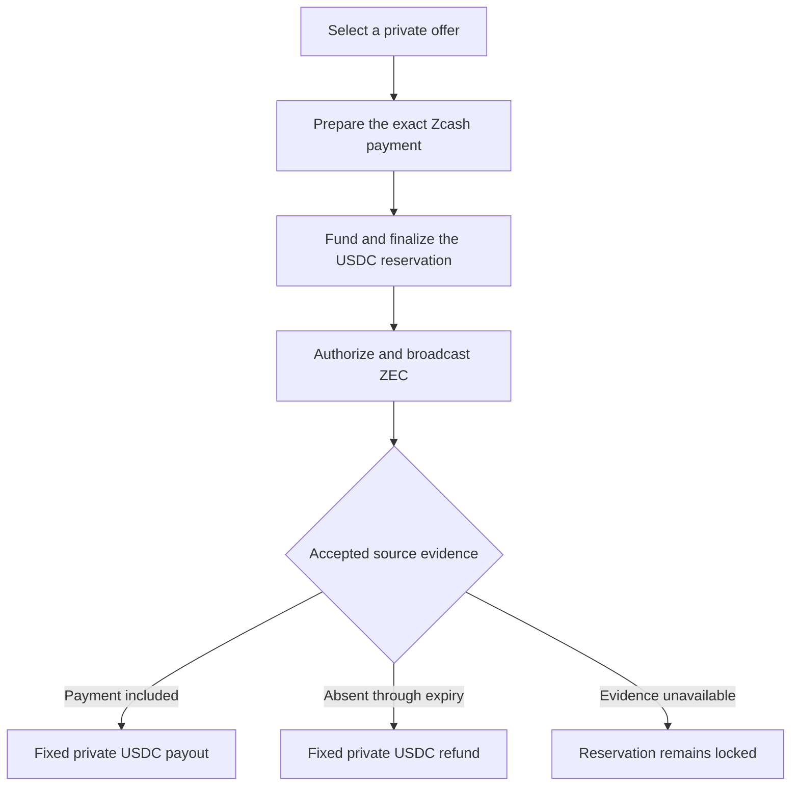

# Zutti

Full-history proving is paused. A separate [SPV prototype](benchmarks/spv/README.md) is approved for evaluation with the mining-validity assumption recorded in the [source-verification review](docs/source-verification.md). No replacement deployment policy or settlement evidence is admitted; the full-validity construction below is retained as a reference.

The [payment-window binding prototype](docs/payment-window-binding.md) implements the prepared Ironwood relation and records its conditional anchor-hash lower-bound argument. The separate [SPV settlement path](docs/spv-settlement.md) now composes proof dependencies and pool/recovery predicates. Genuine binding/window/settlement receipts, current-chain bootstrap, lower-bound review and funded live execution remain unfinished.

Private cross-chain RFQ swaps between native shielded ZEC and privately owned USDC.

Specification draft · 21 October 2026

## 1. Product and status

Zutti lets a user request private offers from market makers, select a price, and exchange native shielded ZEC for a private USDC balance on Ethereum. The same protocol supports the reverse trade by exchanging the parties' roles.

The maker supplying USDC reserves it before the ZEC payer authorizes payment. Cryptographic evidence then determines the reservation's outcome. A valid ZEC payment earns the fixed USDC payout. A refund requires proof that the exact prepared payment never occurred and can no longer occur.

An earned payout has no claim deadline. A delayed proof, disconnected wallet, unavailable relayer, or closed application does not authorize the counterparty to take that payout back.

Zutti consists of a headless client SDK, a maker SDK, a shared protocol core, a private USDC pool, and source-verification infrastructure. Applications own their interface and use the public SDK to request offers, accept a trade and manage its outcome. The Zutti application uses that same SDK.

This document specifies intended behavior. The workspace implements protocol encodings and amounts, Ironwood preparation, native note ownership/encryption, authenticated source replay with transaction authorization and spend/monetary checks, and recursive source, history-query, preparation and private-pool proof programs. Genuine proofs cover early genesis-anchored source prefixes and basic pool deposit/transfer/withdrawal operations; Ethereum contract tests verify genuine component evidence and matching Rust journals. Native authorization now composes preparation receipt verification, Ethereum finalized reservation evidence and source admission before invoking a local signer. Encrypted swap/payment records support restart reconciliation, exact-byte broadcast retries and settlement witness reconstruction. The TypeScript RFQ subset now implements strict message schemas, native amount/fee bindings, authenticated encrypted requests/offers, encrypted owner journals, SDK quote collection, maker quote service controls and a bounded relay. Tests use generated profiles/providers; no live pricing or trading-wallet adapter is configured. Current-chain bootstrap, a matching live authorization run, Zcash-backed reservation and paid/refund settlement proofs, complete independent on-chain recovery, SDK account/fulfillment methods and deployed contracts remain unfinished. See `README.md` for evidence and commands.

### 1.1 Supported asset model

| Asset | Where it exists | What its owner controls |
| --- | --- | --- |
| Native shielded ZEC | Zcash | Ordinary shielded notes and their spending authority |
| USDC backing | The pinned Circle USDC contract on Ethereum L1 | ERC-20 balances held by the Zutti pool |
| Private USDC balance | Notes recorded by the Zutti pool | Independent private spending keys and redeemable claims on the pool's USDC |

No wrapped ZEC is issued. ZEC moves directly between counterparties on Zcash. A private receiving key does not become an Ethereum ERC-20 address: it controls a note backed by the pool's actual USDC.

The source payment profile requires a fully shielded, same-pool transaction. The intended current profile is NU6.3/Ironwood, pinned to the deployed consensus implementation and exact transaction format. Existing funds in another shielded pool may require migration before using this profile. That migration is a separate disclosed transaction and privacy boundary. A swap never silently unshields funds or migrates them between pools as an implementation fallback. [NU6.3](https://z.cash/upgrade/nu6-3/), [ZIP 229](https://zips.z.cash/zip-0229).

Ethereum L1 is the initial destination. This avoids introducing an L2 sequencer and a second destination withdrawal-finality model. The trade-off is Ethereum execution cost. Additional destinations require their own admitted pool, token, finality policy, wallet support, and measured verifier integration.

### 1.2 Product boundaries

- RFQ discovers prices and counterparties. Several makers can compete, but the protocol does not guarantee the best price available anywhere.
- Makers prefund their own trading inventory. Their USDC is payout funding, not an additional security bond.
- Private USDC can be held, transferred inside the pool, withdrawn publicly, or used to fund a reverse swap.
- Arbitrary public DeFi interactions do not become confidential through Zutti.
- Standing offers, sealed auctions, passive shared liquidity vaults, lending, perpetuals, and a destination dark pool are separate applications, not prerequisites for this swap protocol.

## 2. Roles and ownership

Use payment roles when specifying settlement:

| Role | Pays | Receives on successful settlement |
| --- | --- | --- |
| ZEC payer, `Z` | The exact prepared shielded Zcash payment | The fixed private USDC payout note |
| USDC funder, `D` | A funded conditional USDC note | The shielded Zcash payment |

For ZEC to USDC, the user is `Z` and the maker is `D`. For USDC to ZEC, the maker is `Z` and the user is `D`.

Other participants have limited responsibilities:

| Participant | Responsibility | Authority it does not receive |
| --- | --- | --- |
| Integrating app | Collect inputs, display offers and progress, request user decisions | Spending keys or permission to change reviewed terms |
| RFQ relay | Deliver authenticated encrypted messages | Permission to read plaintext RFQs or settle principal |
| Source node | Obtain and validate Zcash chain data | Permission to invent an accepted history root |
| Source prover | Prove consensus transitions and history-index construction | A source spending key or discretionary refund authority |
| Index distributor | Serve public data and verifiable witnesses | Authority over balances or payment status |
| Settlement submitter | Submit a valid proof to Ethereum | Permission to redirect its fixed output |

A maker necessarily participates in quoting and fulfillment. A bot can automate that participation. Depositing inventory alone does not make arbitrary native ZEC payments happen without valid source spending authorization.

## 3. Architecture choices

| Component | Intended implementation | Reason and boundary |
| --- | --- | --- |
| Client SDK | TypeScript, browser and Node interfaces | Application-facing intents, offers, swap resources and private accounts |
| Maker SDK | TypeScript with a Node service runtime | RFQ service, bounded inventory allocation, fulfillment and recovery |
| Protocol core | Rust with explicit native/binding interfaces | One implementation of protocol encodings, commitments, note rules, proof statements and Zcash preparation |
| Wallet integration | Capability-based adapters | Signing remains in the wallet or maker's dedicated inventory signer |
| Private pool | Solidity on Ethereum L1 | Actual USDC custody, note transitions, nullifiers and fixed terminal outcomes |
| Source registry | Solidity verification of proved source updates | Authenticated consensus/history statements under a pinned policy |
| Source validator and prover | Rust, independently reproducible | Full source validation, fork evidence and history completeness |
| Relays and public data services | Replaceable network services | Delivery and discovery without ledger authority |
| Recovery client | Native command-line client using the same core | Claim or refund without the original website or maker service |

Browser bindings are a delivery target, not a claim that existing Zcash wallet crates or the chosen prover already run in a browser. Wallet preparation, local proving, memory use and restart behavior require executable compatibility tests. Unsupported capabilities fail explicitly; private witnesses are not silently uploaded to a hosted prover.

### 3.1 Reuse existing Zcash work accurately

Use reviewed Zcash libraries for their supported keys, note encryption, transaction formats, wallet scanning and partially constructed transactions. Use a consensus implementation such as Zebra as the reference for source validation. Parsing a transaction is not full consensus validation, and a wallet SDK is not the source verifier. [librustzcash](https://github.com/zcash/librustzcash), [Zebra](https://github.com/ZcashFoundation/zebra).

The research checkout of `zcash-light-client` in this workspace is an SPV/transparent-wallet project. Its README does not establish shielded-wallet support or the full-validity profile required here. Competitor SDKs are references, not Zutti components or proof that Zutti's requirements are implemented.

### 3.2 Separate proof workloads

There are two workloads:

1. **Shared public source proving:** validates source history and its derived index. It processes public chain data and can be outsourced without revealing a particular user's swap witness.
2. **Private per-operation proving:** binds transaction details, note ownership, reservation membership and the selected outcome. It runs within the owner's authorized environment because its witness can reveal private trade data.

The development backend pins RISC Zero 3.0.5. Local proving accepts encrypted private witness archives. The separate Boundless demonstration uses generated public inputs uploaded through Pinata/IPFS and requests raw Groth16 proofs that are independently verified against the locally retained image and statement. Only generated public demo witnesses are authorized for this transport; marking real data public would publish it. Confidential delivery to a designated prover would still disclose the witness to that prover and requires a separately validated operating profile.

A recursive Rust-capable proving system is the intended source-verification architecture. Source recursion, complete state validation, representative full-source costs and production verifier admission remain unfinished. Raw Groth16 preparation verification is implemented; it does not establish those missing statements. Any compression setup or proving-system trust assumption must be published. A development or mock proof mode cannot be accepted by a production verifier.

### 3.3 Configuration and versions

The SDK `network` selection resolves a release-pinned deployment profile containing source network/genesis, supported payment formats, Ethereum chain, USDC token, pool, registry, proof identities, encoding versions and source-acceptance policy.

Endpoints and signed manifests are discovery/configuration aids. A server response cannot substitute a different pool, verifier, history root or recipient. Clients authenticate configuration against pinned release trust roots and verify the actual deployed contract identities. An HTTP signature does not prove Ethereum finality or Zcash canonicality.

Every outstanding reservation retains its accepted policy and proof semantics. Routine SDK updates cannot reinterpret old commitments or introduce a new refund rule.

## 4. The two complete swap flows

Illustrative amounts below are not a market quote.

### 4.1 ZEC to private USDC

1. The maker has spendable private USDC inventory. The user has supported same-pool shielded ZEC, source network fees, and a locally controlled private USDC receiving account.
2. The user creates an intent to sell 5 ZEC. The SDK requests encrypted offers from a bounded selection of authenticated makers.
3. The user reviews and selects an offer for a fixed net USDC amount, with all fees, expiry conditions and verification rules visible.
4. Both parties fix their own receiving/refund notes. The user prepares the exact shielded ZEC transaction and its preparation proof while retaining final broadcast authority.
5. The maker verifies the preparation proof and its recovery material, then spends private USDC notes into the agreed conditional reservation.
6. The user verifies the actual reservation and its Ethereum finality, retains recovery data, and checks the remaining Zcash inclusion window.
7. Only then does the user authorize and broadcast the Zcash payment directly to the maker.
8. An accepted source-history proof establishes the payment. The settlement proof consumes the reservation and creates the user's precommitted private USDC note.
9. The user's SDK verifies the confirmed output, decrypts or recovers its note data, and reports the swap as settled. The maker cannot spend that note.

### 4.2 Private USDC to ZEC

1. The user already owns private USDC notes or explicitly deposits USDC into the pool. A deposit from an ordinary Ethereum account is public.
2. Makers return encrypted offers to pay a fixed shielded ZEC amount for the requested USDC input.
3. The selected maker prepares the exact Zcash payment to the user's shielded receiver and supplies its preparation proof and shared recovery material.
4. The user verifies that proof and reserves the agreed private USDC principal. The user retains an independent refund package before funding.
5. After verifying finalized reservation and the source window, the maker authorizes and broadcasts the ZEC payment.
6. Accepted payment evidence releases the private USDC payout note to the maker. The user verifies receipt of its shielded ZEC payment.
7. If the maker never pays, authenticated absence through transaction expiry permits the user's USDC refund.

The maker needs ZEC inventory and a valid Zcash signer in the second direction. An Ethereum contract cannot create that signature on the maker's behalf.

### 4.3 One conditional reservation



This is asynchronous cross-chain settlement. The ledgers do not change in one transaction, and a source reorganization after irreversible destination settlement remains a risk under the declared chain assumptions.

## 5. Private RFQ

### 5.1 Discovery and maker identity

A maker publishes a signed capability announcement with its identity key, current encryption key, supported networks/assets, payment profiles, endpoint, key version and expiry. Identity is a cryptographic pseudonym; registration is not proof of legal identity, solvency or good pricing.

A maker identity is derived from or securely authenticated to its signing key. Key rotations require authorization from the previous identity or an explicitly reviewed new identity. A relay cannot replace the advertised encryption key while preserving the expected maker identity.

The network can allow permissionless maker announcements. The client chooses which makers receive an RFQ using explicit privacy and availability preferences. Registration does not reserve liquidity. Optional inventory evidence is only a snapshot; actual trade safety comes from the later funded reservation.

### 5.2 Encryption and authentication

Use an authenticated message envelope with a versioned header, message type, network domain, request identifier, sender/recipient key identifiers, sequence or replay nonce, expiry, ciphertext and signature.

The intended transport encryption is HPKE using a published supported suite, with independently generated messaging keys. The profile must freeze its exact suite and vectors before interoperability is claimed. Signed transcripts bind the recipient, protocol version, network and message purpose. HPKE alone does not supply application replay protection or authenticate a maker directory. [RFC 9180](https://www.rfc-editor.org/rfc/rfc9180.html).

The wallet encrypts a separate copy for each chosen maker. It supplies a fresh reply-encryption key. Makers encrypt their replies to that key and sign the complete offer. A relay sees delivery metadata but does not need plaintext access.

Messaging, Zcash spending, private-USDC spending, private-USDC viewing, and recovery-encryption keys are separate capabilities. Possessing a quote-decryption key does not authorize a note spend.

### 5.3 Request and offer

An initial request contains only what is needed to price the trade: pair, direction, exact input amount, supported profile, requested validity and fee preferences. Exact payment identity and full settlement details go to the selected counterparty during preparation.

An offer binds the request, maker identity, input/output assets, exact input, net output, complete fee terms, acceptance expiry, supported payment profile, source-acceptance policy, maker nonce and signature. Its signature is an offer, not evidence that funds are reserved.

An offer ID identifies immutable signed content. The client retains the displayed offer and its digest; a server cannot reuse that ID for revised amounts, fees or policy. Settlement details fixed during preparation must satisfy that signed offer and receive the corresponding owner's approval.

The SDK verifies offer authentication, request binding, units, policy support, freshness and complete costs before presenting an offer as actionable. It does not replace a selected offer with a different price or maker without new user approval. Selecting a maker does not authorize payment until the subsequent checks and wallet approval succeed.

### 5.4 Three different timing rules

| Timing rule | Meaning |
| --- | --- |
| Offer acceptance expiry | The selected offer must be accepted under its signed terms before this deadline |
| Zcash transaction expiry height `E` | The prepared payment may be included through `E`, but not first included at `E + 1` |
| Paid claim timing | A qualifying payment's USDC entitlement has no claim deadline |

Quote expiry never revokes an already funded reservation or an earned payout. The source expiry is a block height, not a wall-clock refund promise. Source confirmation and proof-delivery buffers are additional admission checks.

Encrypted RFQs are not automatically a sealed-bid auction. The user can read offers as they arrive. No auction closing rule, universal price guarantee or verifiable inclusion of every possible offer is implied.

## 6. Private USDC account and notes

### 6.1 Backing and balance

The Ethereum pool holds the pinned USDC token. On mainnet the token identity must match Circle's published deployment; the currently listed Ethereum USDC address is `0xA0b86991c6218b36c1d19D4a2e9Eb0cE3606eB48`. Test environments use explicitly identified test assets, never a mock presented as real USDC. [Circle contract addresses](https://developers.circle.com/stablecoins/usdc-contract-addresses).

`zutti.account()` is a private wallet view over owned notes. It is not a public per-user balance table or an ERC-20 account for the private receiving key. Its summary distinguishes spendable notes, reservations, pending deposits, terminal outputs awaiting synchronization, and actual public wallet tokens.

Every issued note is backed by conserved pool value. A deposit issues notes only after actual token receipt. A withdrawal consumes notes and transfers that value out. Ordinary transfers and swap settlement move note ownership inside the pool without transferring ERC-20 principal between public recipient addresses.

### 6.2 Ordinary notes

Conceptually, an ordinary note commits to:

```text
note = (domain, asset, value, owner_key, note_nonce, randomness)
commitment = Commit(note)
nullifier = PRF(owner_nullifier_secret, domain, note_nonce)
```

These equations describe required bindings, not a final hash/curve parameter specification. The deployment profile must fix the commitment, PRF, tree parameters, encodings and ownership relation, with cross-language test vectors.

The spend proof establishes authorized ownership, valid note membership, range constraints, non-duplication and per-asset conservation. The contract rejects reused nullifiers. Knowing a note commitment or its public encryption key must not reveal or authorize its future spending nullifier.

Recipient recovery data is authenticated and encrypted to an independently controlled receiving/viewing key. Output commitments and ciphertext digests are bound to the same proof statement. The recipient validates note contents against the confirmed commitment before treating value as usable.

The current native development implementation uses a secp256k1 spending key, an independent X25519 viewing key and a separately committed secret nullifier key. Note signatures bind the exact domain, note commitment and intended operation. Nullifier derivation checks the secret against its commitment in the recipient data, preventing a sender who knows only the note opening from calculating the future nullifier. Encryption uses HKDF-SHA256 and XChaCha20-Poly1305 with authenticated context. These native primitives do not yet implement membership/conservation proofs or backed note issuance.

### 6.3 Keys and recovery

The note-spending authority belongs only to its owner. It must not derive from a quote secret shared with a maker, a source transaction ID, a public order identifier or an ordinary shared encryption session.

A private account can receive without first making a public USDC deposit or publishing an Ethereum recipient address. A source Zcash signer, private-USDC owner and optional Ethereum gas/deposit signer are separate roles. The adapter layer requests only the capabilities required by the selected action.

Key backup alone does not necessarily restore unpublished swap witnesses. The SDK preserves an encrypted personal backup covering note recovery data, swap records and the owner's key recovery information. Public output ciphertexts support note scanning; authenticated trees support witness reconstruction. Private reservation transcripts also need a retained, independently recoverable record.

### 6.4 Deposits, transfers and withdrawals

- **Deposit:** an explicit owner-authorized ERC-20 transfer into the pool, followed by confirmed note issuance. The depositor, amount and timing are public.
- **Private transfer:** spend owned notes into receiver and change notes. Ownership, valid encryption and conservation are checked without publishing private values or recipients.
- **Public withdrawal:** spend private notes into a pinned public USDC transfer. Recipient, amount, timing and pool origin are visible.

No ordinary operation silently deposits from a public wallet to cover a private balance shortfall. Fragmented notes can require consolidation; its proofs, fees and progress are included in the operation rather than reported as a completed swap.

## 7. Bind the trade before reserving USDC

### 7.1 Domains and encoding

All commitments and signatures bind a domain containing protocol and encoding versions, source network/genesis, destination chain, pool, token, payment profile, source policy and proof identities.

The Rust core owns canonical binary serialization. Each schema defines field widths, endianness, lengths and bounds. Wire integers are losslessly encoded; JavaScript numbers are not used for monetary quantities. Reject noncanonical encodings, unknown required fields and out-of-range values. Display formatting never changes the committed bytes.

Separate domains exist for quotes, order commitments, source memos, reservations, ordinary notes, order-use tags, escrow nullifiers and recovery envelopes.

### 7.2 Fixed outcomes and order commitment

Let `x` be the ZEC payment and `y` the net private-USDC principal. Before constructing the source transaction, both sides agree on private order terms:

```text
order_terms = (
  domain,
  accepted_offer_digest,
  x,
  D_shielded_receiver,
  y,
  payout_note_commitment,
  refund_note_commitment,
  payout_ciphertext_digest,
  refund_ciphertext_digest,
  fee_terms,
  recent_source_block_hash H0,
  recent_source_height h0,
  nonzero_source_expiry E,
  order_nonce,
  order_randomness
)

O = Commit(order_terms)
```

`Z` independently creates its private-USDC payout note. `D` independently creates its private-USDC refund note. Each proves that its fixed note has the agreed asset/value and supplies the corresponding recoverable output data. Neither provides its spending secret to the other.

`H0` must be authenticated as the block at `h0` on the accepted source ancestry, with `h0` after the index start. The reservation proof binds that verified anchor into `O`; a payer-supplied hash labelled recent is insufficient. Terminal proofs also establish that their accepted checkpoint extends this same `H0`. The deployment statement defines the header-history membership/ancestry evidence used for these checks.

Note-output encryption uses associated data that can be fixed before `O`, such as the deployment domain, note commitment and output purpose. It must not depend recursively on an order commitment that already contains that ciphertext digest.

`O` contains no transaction ID and no value that depends on that transaction ID. This avoids a circular dependency when `O` is placed in the source transaction's encrypted memo.

### 7.3 Source transaction and reservation commitment

`Z` constructs a transaction `T` with a designated real shielded output paying `x` to `D`. Its encrypted memo contains the protocol domain, `O` and `H0`. Let `t` be its exact effect-committing transaction ID under the pinned format.

```text
R = Commit(domain, O, t, reservation_randomness)
U = Hash(order_use_domain, domain, order_nonce)
```

`R` hides `t` with fresh randomness. `U` is a unique order-use tag preventing one order from creating multiple principal reservations. The public tag must not be derived from a publicly searchable source transaction ID.

The raw `t`, an unsalted hash of it, source recipient and trade amounts are not published as Ethereum swap fields. The source transaction and its ID still appear on the public Zcash chain; the goal is to hide their link to a particular destination settlement.

### 7.4 Source payment preparation proof

The preparation proof establishes all of the following:

1. The version-correct transaction-ID algorithm applied to the prepared effects gives the `t` committed in `R`.
2. The designated output is enabled, real and correctly encoded, and pays `x` to the agreed shielded receiver.
3. Its ciphertext, ephemeral key, authentication tag and version-specific derivations encrypt a recoverable note and the required memo. A matching note commitment without correct ciphertext is insufficient.
4. The source memo binds the same `O` and `H0`, and the transaction commits to the agreed nonzero expiry `E`.
5. The payment profile forbids transparent components and per-swap cross-pool value movements.
6. Order, reservation, output and version domains all agree.

The preparation proof does not establish that the payment will be mined. The payer may withhold authorization, never broadcast, or spend an input elsewhere. Only accepted source inclusion establishes payment for settlement.

Before finalizing the reservation, the payer retains a final authorization capability without which `T` cannot be broadcast successfully. The counterparty receives enough effect/proof data to validate the commitment, but not a complete broadcastable transaction. Zcash's effect/auth separation is a foundation; exact wallet/prover integration and format semantics still need tests. [ZIP 244](https://zips.z.cash/zip-0244), [ZIP 229](https://zips.z.cash/zip-0229).

Once reserved, an authorized transaction may be rebroadcast unchanged. Any fee or recipient change that changes `t` requires a new agreement and reservation; it cannot silently reuse the old payout. A format-permitted reauthorization that preserves `t` must preserve every property the preparation proof binds.

### 7.5 Bilateral recovery handoff

Before funding, `D` obtains and checks `t`, openings for the agreed reservation, the verified preparation statement and enough escrow witness data to refund independently. Before source authorization, `Z` obtains and checks the finalized reservation opening, fixed output data and enough settlement witness data to claim independently.

The shared recovery transcript includes only information needed for this swap. It contains no source spending key or either party's private-USDC spending key. It is encrypted separately for each party's personal retention. Acknowledging its receipt is not a substitute for local verification and durable storage.

The ZEC payer's default client must not authorize `T` until this persistence gate succeeds.

## 8. Fund the conditional reservation

`D` spends existing private USDC notes into a conditional note for `y`, plus private change. Its hidden opening binds `O`, `R`, both terminal note commitments, their ciphertext digests and a shared random escrow-nullifier secret.

Conceptually:

```text
escrow = (domain, USDC, y, O, R, payout_commitment,
          refund_commitment, output_ciphertext_digests,
          escrow_nonce_secret, escrow_randomness)

C_escrow = Commit(escrow)
N_escrow = Hash(escrow_spend_domain, domain, escrow_nonce_secret)
```

Both parties can know the escrow's terminal nullifier material. That knowledge is not sufficient to spend it: either terminal proof still has to satisfy the fixed payment or absence predicate. Ordinary output-note nullifiers depend on their separate owners' secrets.

The funding proof checks input ownership/membership, no repeated inputs, conservation, fixed terminal principal values, the correct preparation proof, the authenticated source anchor, and consistent commitments/domains. The contract consumes `U`, consumes the funder's input nullifiers and inserts `C_escrow`.

Before funding, `D` checks that the agreed source registry and policy are live, supported and consistent with its verified source view. A stalled or conflicting registry is a reason to refuse new exposure, not a reason to accept an operator's replacement root.

Payout and refund notes are alternatives. Funding does not mint both, and neither party can spend an ordinary output note before a valid terminal transition creates it.

### 8.1 Reservation finality gate

Before authorizing source payment, `Z` verifies:

- The exact Ethereum network, immutable pool, token, proof versions and accepted source policy.
- The funded note's valid membership and its opening against the agreed reservation and output commitments.
- Actual Ethereum finality, not a pending receipt, sequencer acknowledgement, HTTP status or maker screenshot.
- Sufficient remaining source inclusion time after preparation, destination finality, source propagation and policy buffers.
- Durable local recovery material and access to the required public evidence.

Ethereum RPC replies are not cryptographic finality evidence by themselves. The strong client profile uses a verified Ethereum chain view and verifies relevant receipts/state against it. A user-selected ordinary RPC-only profile introduces provider trust and must be labelled explicitly. The wallet/node bootstrap assumptions and chosen finality-verification mechanism are deployment requirements. [Ethereum proof of stake](https://ethereum.org/developers/docs/consensus-mechanisms/pos/).

If the source window is no longer safe, `Z` does not authorize payment. A funded reservation still follows its evidence-based refund path; it is not immediately cancellable.

## 9. Payment or proven impossibility

Both outcomes spend the same `C_escrow` and publish the same deterministic `N_escrow`. The destination refuses an already consumed escrow nullifier. Each terminal proof proves conditional-note membership without exposing its leaf position.

The intended public entry point is one escrow-settlement operation. A private branch selector can choose the paid or refund predicate while producing the same output shape. Hiding the branch requires an actual zero-knowledge implementation and uniform public statement; a non-zero-knowledge execution receipt cannot be substituted. Branch secrecy does not remove timing or counterparty knowledge.

### 9.1 Paid predicate

The proof establishes that:

1. The escrow opens to the accepted domain, `O`, `R` and fixed outputs.
2. The same hidden `t` in `R` exists in an authenticated source-history index.
3. Its inclusion height is after `h0`, no later than `E`, and within the accepted stable prefix.
4. The index root belongs to an accepted sufficiently confirmed source checkpoint extending `H0` under the escrow's policy.
5. The preparation proof applies to that `t` and the agreed payment.
6. The new ordinary note and ciphertext are exactly the precommitted payout to `Z`.

The contract consumes `N_escrow` and inserts that payout note. The submitter does not choose a new recipient or amount.

There is no destination claim deadline. A later cumulative accepted checkpoint can prove an earlier qualifying payment. Old note/index data and applicable verifier code must remain usable or reconstructable; retention policy cannot silently expire this entitlement.

### 9.2 Refund predicate

The proof establishes that:

1. The same accepted escrow, order and prepared `t` are being checked.
2. Accepted stable source history extends `H0` and reaches beyond `E` under the same ancestry and policy used for paid claims.
3. The complete eligible history contains no `t` through `E`.
4. The recent unpredictable `H0` bound into `T` excludes a payment predating the indexed eligible interval, under the hash/unpredictability assumptions.
5. The committed nonzero expiry makes later valid inclusion impossible.
6. The new ordinary note and ciphertext are exactly the precommitted refund to `D`.

The contract consumes the same `N_escrow` and inserts the fixed refund note. Expiry permits inclusion at `E`; an absence proof must cover that boundary. [ZIP 203](https://zips.z.cash/zip-0203).

A timer, an unanswered request, a missing claim or an RPC `not found` result is not refund evidence. There is no unilateral early cancellation once principal is reserved. A cooperative cancellation would need a separately proven safe protocol and is not implied by a generic SDK `cancel()` method.

### 9.3 Exclusivity and its limits

Under one correctly verified source history, the prepared payment cannot be both included through expiry and absent through expiry. Both branches also consume one escrow nullifier, so Ethereum can apply at most one terminal spend.

Nullifier uniqueness alone does not prove economic fairness. A verifier accepting a false absence statement could pay the wrong branch first and still prevent a double spend. Therefore source completeness, validity and ancestry are central safety obligations.

If evidence cannot be obtained or proved, funds can remain locked. If Zcash halts before the required height, wall-clock time does not create source history beyond expiry. No committee or administrator may manufacture a refund to bypass that condition.

## 10. Committee-free source verification

### 10.1 Required statement

An accepted source update attests to a valid source history and a complete derived index. It binds:

```text
source_genesis
consensus_rules_version
proof_program_identity
parent_verified_state_commitment
new_verified_state_commitment
source_tip_hash / height / cumulative_work
stable_source_hash / height / cumulative_work
stable_consensus_state_commitment
stable_header_history_root
history_index_start
stable_history_index_root
source_acceptance_policy_id
```

The exact circuit/public-input layout is a deployment artifact requiring test vectors. A server cannot post an arbitrary root and make it authoritative by signing it.

The tip fields rank and confirm candidate histories. The stable fields identify a proved ancestor selected by the acceptance policy. Settlement uses the index root at that stable ancestor, covering transactions only through its stated height; it never treats an index containing unconfirmed tip transactions as stable evidence. Header-history evidence authenticates `H0` and its relationship to this prefix. The state transition proves that all these roots and heights describe the same history.

### 10.2 Full validity

The target verifier proves source transitions with all applicable consensus checks, including header linkage, actual difficulty rules, proof of work, transaction and authorizing-data commitments, transaction validity, state updates, shielded proofs and spend/nullifier rules. It must handle every transaction format permitted in the blocks it validates.

Restricting Zutti's own payments to Ironwood does not remove historical or other currently valid transaction formats from full block validation. A header-membership proof and full sampling are not substitutes for full transaction/state validation.

Validation is deterministic and content-addressed. Relevant source state is represented by authenticated commitments with proven reads/writes. Parallel checks or batch proofs are acceptable only if their composition proves the complete transition and preserves consensus behavior. Comparing against a full node after proving a weaker statement does not strengthen that statement on Ethereum.

### 10.3 Bootstrap

Bootstrap must establish the initial authenticated consensus state from genesis and the complete required prefix through the index start, using reproducible proofs. The registry starts from the fixed genesis/protocol rules and verifies this derivation.

A locally loaded state snapshot, a trusted recent checkpoint, an assume-valid shortcut, or a consensus client's historical checkpoint path cannot be relabelled as full prefix validation. Reusing Zebra requires auditing the exact validation paths and disabled checks. The bootstrap proof and its data must be independently reproducible.

The history index can begin at a proved recent block after that validated prefix; it need not store transaction IDs from genesis. Orders require `H0` after the index start and prove the payment's birth binding. This limits index scope without replacing full bootstrap validity with trust in an operator's snapshot.

### 10.4 Complete history index

The baseline derived index is an authenticated sparse dictionary keyed by the full transaction ID. A value records presence and first inclusion height after the index start. An empty value proves absence. Any consensus-permitted duplicate transaction-ID case requires defined deterministic insertion behavior; it cannot erase earlier presence.

Each proved block update must:

1. Parse the actual complete block transaction list under the applicable format rules.
2. Compute every correct transaction ID and applicable authorizing-data commitment.
3. Reconstruct the canonical source commitments, transaction count/tree shape and duplicate/padding behavior.
4. Prove all required consensus checks and state transitions.
5. Insert every genuine transaction into the derived index.
6. Link the resulting index and consensus state to the prior proved state.

The index is Zutti machinery, not a standard Zcash non-inclusion API. An ordinary Merkle membership path proves one leaf, not that all transactions were enumerated. Accepting arbitrary 32-byte leaves or a collapsed subtree as a transaction can manufacture false absence and must fail.

The refund fact is bounded by the prepared transaction's authenticated birth and expiry. The shared cumulative index is an implementation of that predicate, not an entitlement to trust a global transaction lookup service. A direct complete-interval proof could be an equivalent future optimization only if it preserves exactly the same accepted ancestry, completeness and expiry guarantees.

### 10.5 Fork choice and stable ancestry

Source validity and source canonicality are separate. A valid-history proof cannot establish that no unseen heavier fork exists.

The registry verifies candidate source updates and ranks eligible valid histories by cumulative work, not block count. Its policy defines candidate observation, competing-fork handling, confirmation depth, publication/maturity delay, freshness and stable-prefix advancement. Those parameters require adversarial analysis and measurements before deployment; no arbitrary confirmation number is asserted here.

All checkpoint roots usable for irreversible settlement must lie on one consistent accepted stable ancestry. Unsettled candidate heads may reorganize above it. A valid higher-work conflict below a previously settled stable prefix is a deep-reorganization incident: new acceptance must stop or enter the published fail-closed policy. It cannot silently replace history beneath completed payouts.

Safety assumes sufficient honest source work and that relevant competing chain evidence reaches the verifier under the declared observation policy. Permissionless proof submission reduces dependence on a particular operator; it does not guarantee a prover exists, is affordable, or observes every fork in time.

The implementation must specify the full registry state machine and parameter values before it accepts economic deposits. Listing these fields is not a completed canonicality construction.

### 10.6 Data availability and independent proving

Publish validated block data, index snapshots/deltas and proof artifacts with content hashes. Clients verify them against accepted commitments. Path distributors can be untrusted, but omission can block progress.

A counterparty holding `t` can supply paths to the other party. Independent recovery also needs a bulk/window synchronization path that does not depend on that counterparty or an irreplaceable server. Querying a generic provider with `t` leaks payment interest to that provider. Private retrieval/PIR is not assumed implemented.

Shared source provers process public chain data only. Per-swap private witnesses remain local by default. A public proving network does not automatically provide witness confidentiality.

### 10.7 Why this is difficult

The proving program must connect consensus validation, multiple cryptographic proof/signature systems, authenticated state and complete indexing across historical upgrades. Recursive proof composition must preserve those checks while making the Ethereum statement affordable. Full-node validation shortcuts, unsupported zkVM dependencies, and omitted authorizing data are all possible integration failures.

The decisive milestone is a real-data source-verification prototype demonstrating paid inclusion, expired absence and rejection of false absence, with measured prefix/bootstrap and ongoing proving costs. This work cannot be replaced by a mocked verifier while claiming an end-to-end trustless swap.

## 11. Ethereum contracts and proof interfaces

### 11.1 Private USDC pool

The pool owns token custody, note commitments, accepted note roots, ordinary spent nullifiers, consumed order tags and consumed escrow nullifiers. It verifies every value transition before updating state.

Conceptual contract operations are:

| Operation | Required effect |
| --- | --- |
| `deposit` | Receive actual pinned USDC and issue the authorized note output |
| `transact` | Apply an authorized conserving private transfer or public withdrawal |
| `reserve` | Consume private inventory and create one correctly bound conditional note |
| `settle_escrow` | Apply one valid paid/refund transition to its fixed output |

These are contract responsibilities, not extra routine SDK calls. The exact ABI must bind all public outputs and ciphertext digests to the verified statement.

Token calls use safe transfer handling and measured balance accounting. State updates and external calls must be protected against reentrancy and partial application. No arbitrary token adapter, external call target or fee-on-transfer asset is admitted by the initial USDC profile.

### 11.2 Source registry

The registry owns accepted source policy, verified candidate histories, cumulative work comparisons, stable ancestry and authenticated index roots. Its writes require valid source proofs and the declared transition policy. There is no privileged root setter, trusted checkpoint committee or administrator-selected per-swap outcome.

### 11.3 Verifier boundaries

| Proof | Private witness | Required binding |
| --- | --- | --- |
| Payment preparation | Source effects, output opening/encryption randomness, private order terms | Recoverable correct payment, memo, expiry and exact hidden `t` |
| Private note transition | Owned note openings, spending authority, paths | Membership, authorized spend, ranges, conservation and encrypted outputs |
| Reservation | Funding notes, order/escrow openings, preparation evidence | Actual private funding, one-use order, both fixed terminal outcomes |
| Source transition/index | Public block data and authenticated source state | Complete consensus transition, work and complete index update |
| Escrow settlement | Escrow opening/path, source membership or absence witness | Accepted policy/root, one terminal nullifier, fixed authorized output |

Where a proof verifies another proof, it pins the expected verification key/program identity and full statement. Verifying a receipt from an arbitrary program is not sufficient. Public input hashing, field conversion and byte order must have explicit cross-language vectors.

Registry acceptance and source predicates must be checked against canonical contract state at execution, not an SDK's cached assertion. Invalid or unknown proof versions fail closed.

### 11.4 Retention and ordinary root rotation

The pool supports refreshed membership witnesses for unspent notes against current accepted note roots. Removing an old recent-root cache entry does not erase a note or authorize its refund. Public append data, encrypted output data and authenticated snapshots must support reconstruction.

Source roots or cumulative successors usable for earned claims remain verifiable. Any future pruning/migration scheme must preserve replay prevention, note ownership and the no-paid-claim-deadline invariant. An operation record expiring on an application server cannot terminate a contract entitlement.

## 12. SDK contract

### 12.1 Public shape and ownership

Zutti has two headless public packages: `@zutti/sdk` for applications and `@zutti/maker-sdk` for maker services. They share the same protocol core, private-account engine, wallet bindings and settlement/recovery rules. Applications own their interface; the SDK owns protocol orchestration. The RFQ subset is implemented. The complete reference below remains the target contract; account, funded execution and independent on-chain recovery are not implemented package exports yet.

The normal application flow is `intent()` -> `offers()` -> `accept()`. Acceptance coordinates the entire exchange through confirmed, recoverable receipt. Status updates use an optional `on_status` callback. There is no additional routine execution or resumption step.

Zutti-owned names use `snake_case`. Public monetary amounts are decimal strings in whole asset units: `"5000"` means 5,000 USDC when `asset` is `"USDC"`; `"5"` means 5 ZEC when `from` is `"ZEC"`. The SDK validates precision and converts to exact integer base units internally. USDC has six decimals, ZEC eight and ETH eighteen. It rejects excess precision, negative amounts, scientific notation and out-of-range values rather than silently rounding an authorization. Trade, deposit, transfer and withdrawal principals must be positive; zero remains valid for an explicitly zero fee cap. Monetary inputs and outputs use the same convention. JavaScript floating-point arithmetic is not used to authorize funds.

Normal integration code does not supply database connections, storage engines, file paths, messaging keys, proof steps or source-verification parameters. The supported runtime owns those mechanisms. Wallet capabilities, persistent recovery and admitted verification profiles remain real implementation requirements behind the abstraction.

### 12.2 Application setup and complete swap flow

`alice_wallet` below is the owner's connected Zutti-compatible wallet handle. `set_status` is the application's existing callback for receiving status updates; it is optional. The SDK does not require an additional logging helper, rendering component or framework hook.

```ts
import { create_zutti } from "@zutti/sdk";

const zutti = create_zutti({
  network: "testnet",
  wallet: alice_wallet,
});

const intent = zutti.intent({
  from: "ZEC",
  to: "USDC",
  amount: "5",
});

const offers = await intent.offers();

// The user reviews the returned offers and selects offer_01.
// Offer IDs here are illustrative; actual IDs come from offers.items.
const swap = await intent.accept({
  offer_id: "offer_01",
  on_status: set_status,
});

const receipt = swap.receipt;
```

For an illustrative gross quote of 200 USDC and a maker fee of 50 basis points, the selected offer pays exactly 199 USDC net. `receipt.received` is `{ asset: "USDC", amount: "199" }`. Network fees and their payer are separately disclosed; these are not live market or network-cost measurements.

The SDK performs the following inside `accept()`:

1. Resolve the owner's receiving data and bind the selected offer's exact terms.
2. Prepare the exact shielded Zcash payment while withholding final source authorization.
3. Establish, verify and persist both parties' recovery material.
4. Coordinate the private USDC reservation and verify its actual funding and Ethereum finality.
5. Recheck the remaining source window and obtain the required source-wallet authorization.
6. Broadcast the exact prepared payment, obtain qualifying verified source evidence and settle the fixed payout.
7. Verify the owner's received output and its recoverability before reporting success.

Status updates expose the stage and any blocking condition. Typical stages include `preparing`, `awaiting_reservation`, `reserved`, `awaiting_authorization`, `payment_submitted`, `payment_confirming`, `settling` and `settled`. They advance only when the relevant authorization/evidence checks pass. The optional callback does not drive the protocol; callback failure cannot disable persistence, change terms or create a second swap.

The same shape handles the reverse direction:

```ts
const reverse = zutti.intent({
  from: "USDC",
  to: "ZEC",
  amount: "100",
});

const reverse_offers = await reverse.offers();

// The user reviews and selects the returned offer_02.
const reverse_swap = await reverse.accept({
  offer_id: "offer_02",
  on_status: set_status,
});

const reverse_receipt = reverse_swap.receipt;
```

For an illustrative gross quote of 2.5 ZEC, a 50-basis-point maker fee is 0.0125 ZEC and the net output is 2.4875 ZEC. `reverse_receipt.received` is `{ asset: "ZEC", amount: "2.4875" }`. The maker pays its source transaction fee in addition to the agreed payment; that fee cannot reduce the fixed received principal.

### 12.3 Wallets, routes and destinations

The public constructor takes a single `wallet` handle. The supported wallet integration coordinates the underlying capabilities:

| Capability | Responsibility |
| --- | --- |
| Zcash | Supported shielded receiving/scanning, exact payment preparation and spending authorization |
| Private USDC account | Independent local note ownership, viewing, authorized pool spends and encrypted recovery |
| Ethereum, when required | Explicit public token deposits and direct gas payment |

The wallet handle is not a raw seed, a public address, or a promise that every existing wallet supports Zutti. Supported adapters must be implemented and tested. The source adapter preserves the bound effects and withholds final broadcast authority until reservation checks pass. Missing capabilities produce typed errors. Private proving remains in the authorized owner runtime; an unsupported device cannot silently fall back to uploading private witnesses.

`network` selects a release-pinned pair of deployments: source network/genesis and payment profile, Ethereum chain, exact USDC token/private pool, proof identities and verification policy. A profile without admitted deployed verifiers is unavailable. No unknown route resolves to an arbitrary bridged substitute.

For ZEC to USDC, the destination defaults to the owner's private USDC account. For USDC to ZEC, it defaults to the connected wallet's supported shielded receiver. The SDK resolves fresh receiving data during acceptance and binds it before payment preparation and reservation funding. Initial RFQs do not require a public receiving address. Receiving a private USDC note does not require an initial USDC deposit or a public Ethereum signer when the selected offer uses an admitted submission arrangement. Public USDC withdrawal is a separate explicit account action.

Client construction does not create a new economic intent or grant spending permission. Once the owner is connected/unlocked, background reconciliation can continue an existing operation only within its retained authorizations and accepted terms. A new required signature, changed fee budget or unavailable capability remains an explicit action requirement.

### 12.4 Offers and acceptance boundaries

`intent()` creates an immutable local request without contacting makers or moving funds. `offers()` selects authenticated compatible makers within the configured privacy budget, encrypts a separate request to each, collects bounded responses and verifies them. Each maker's service prices its request and returns a signed encrypted offer; the relay does not set the price.

An offer exposes exact input, gross output, maker fee, net output, separately payable network/submission fee caps, maker identity, absolute acceptance deadline and pinned settlement policy. Its ID identifies immutable signed content. An offer is not evidence of reserved liquidity. A feed informs the maker's commercial decision; settlement does not use a price oracle to decide whether the agreed payment occurred.

`offers.items` contains verified actionable offers. An empty result is a no-offer outcome. A timed-out collection may contain valid offers and does not prove all makers declined. Repeated collection for the same immutable intent retains its recipient budget; it does not silently fan out to additional makers. Changing the pair, amount, minimum output or privacy scope requires a new reviewed intent.

`accept()` validates that the selected ID belongs to the retained intent and that the bilateral acceptance transcript binds the offer before its deadline. Later preparation/finality stages can continue under those accepted terms. The SDK never silently changes maker, price, destination, fee authorization or source transaction to make progress.

| Outcome | Public contract |
| --- | --- |
| Confirmed successful exchange | Resolve to `SettledSwap` with a verified receipt and recoverable owner output |
| Bounded wait/interruption | Typed pending error with the existing operation ID and verified snapshot; retained work remains eligible for automatic continuation |
| Required owner action | Typed action-required error with the known operation ID and required capability/authorization |
| Confirmed refund | Distinct refund error/outcome with a verified refund receipt |
| Rejected/expired unfunded offer | Report rejection without presenting it as funded recovery or successful exchange |

A funded reservation or submitted payment is not success. Aborting a wait does not cancel a source transaction or refund principal. An expired unfunded offer requires a newly selected fresh offer; the SDK cannot automatically replace the user's price.

### 12.5 Private account and existing swaps

```ts
const account = zutti.account();

const balances = await account.summary();
const pending = await account.pending();
const history = await account.history({ limit: 20 });

const receiver = await account.receive();

await account.transfer({
  asset: "USDC",
  amount: "20",
  to: private_receiver,
  on_status: set_status,
});

await account.withdraw({
  asset: "USDC",
  amount: "25",
  to: ethereum_address,
  on_status: set_status,
});

const backup = await account.backup();
```

`private_receiver` is receiving data supplied by the recipient through their own account; `ethereum_address` is the explicitly selected public withdrawal destination. These are optional independent account actions with separately reviewed execution fees. Receiving a forward swap does not require a prior deposit, public withdrawal or private transfer.

`summary()` distinguishes spendable, reserved and pending private principal from any connected public wallet balance. Missing data is unavailable, never zero. ZEC remains in the connected source wallet rather than the Ethereum private pool. Lists use `{ items, next_cursor, complete }`; incomplete reads remain marked incomplete.

A deposit resolves after confirmed actual token receipt and recoverable private credit. A private transfer resolves after confirmed recoverable recipient output. A withdrawal resolves after the confirmed public token transfer. ERC-20 approval alone is not a confirmed deposit.

Existing swaps can be inspected or observed without starting another trade:

```ts
const existing = zutti.swap("swap_01");

const snapshot = await existing.summary();
const unsubscribe = existing.subscribe(set_status);
```

The resource resolves from authenticated local/recovered records. A public ID alone is not a recovery credential or sufficient witness data. `summary()` reconciles real evidence and identifies stale/unavailable observations. `subscribe()` emits status updates and returns an unsubscribe function. Live callbacks are session-local; restoring an operation does not recreate a JavaScript callback from a previous session.

### 12.6 Persistence, automatic continuation and independent recovery

The SDK/runtime owns an encrypted persistent operation journal and its migrations, transactions and worker coordination. Normal constructors expose no database, storage or directory parameter. Before an economic effect the SDK durably records the operation identity, accepted terms, prepared payment identity, authorization state and required recovery material. If required persistence is unavailable, it stops before the effect rather than relying on an application callback.

Sensitive payloads are authenticated and encrypted before database writes. Decryption authority belongs to the owner's wallet/authorized runtime, not the database operator. Records are bound to owner, deployment and version. Minimal operational metadata may remain visible. Database contents cannot set balances or establish chain payment status; the SDK reconciles authenticated evidence before continuing. Stale or rolled-back records must not authorize duplicate effects.

On reconnect/unlock or maker startup, the runtime loads retained records, reconciles actual chain effects and automatically continues eligible existing work. It retains the same transaction identity, destinations and fee limits. A fresh signature or larger fee budget requires owner authorization. Closed/offline clients do not promise continuous execution; restarting restores eligible continuation. Database/worker deployment still needs durable retention even though it is internal to the public SDK interface.

Ordinary integrations do not call a manual swap/account resumption method. Calling `intent.accept()` again with another offer or creating another deposit is not the recovery mechanism. Creating a new economic operation does not replace a pending one.

Personal recovery is explicit and portable:

```ts
// On another supported installation, with the owner's recovery capability:
const recovery = await zutti.restore(backup);

await zutti.close();
```

The encrypted package covers note data and unpublished operation witnesses, not merely a list of IDs. Restore authenticates owner/deployment scope, imports records and reconciles evidence. It grants no new spending authority. Browser/runtime storage alone is not an independent backup; losing unpublished witnesses cannot be repaired from a public swap ID or necessarily from a wallet seed alone.

Explicit `claim()` and `refund()` remain available to independent recovery tools using the same core. They settle only fixed authorized outputs. Claiming requires qualifying payment evidence; refunding requires accepted complete absence through inclusive expiry and the required stable descendant. A timer, missing claim or RPC lookup failure cannot authorize a refund. The paid entitlement has no claim deadline.

Refunds return USDC to its funder: the maker for ZEC-to-USDC and the user for USDC-to-ZEC. Fees already spent are not automatically returned. A universal funded cancellation is not part of the API.

`close()` flushes retained state and closes local workers/transports. It does not cancel a source payment, revoke an earned payout or erase recovery material. A different supported client must be able to recover without the original website or database service if the owner retained the required package and capabilities.

### 12.7 Public type and completion reference

The following reference fixes inputs, outputs and lifecycle boundaries. It is not additional setup code for an ordinary application. `WalletProvider` is supplied by a supported wallet integration and implemented by the wallet/core bindings.

```ts
import type { WalletProvider } from "@zutti/sdk";

type Network = "mainnet" | "testnet";
type Asset = "ZEC" | "USDC";
type FeeAsset = Asset | "ETH";
type Amount = string; // Validated decimal whole-asset units.
type SwapId = string;
type OperationId = string;
type Unsubscribe = () => void;

type IntentInput =
  | { from: "ZEC"; to: "USDC"; amount: Amount; min_output?: Amount }
  | { from: "USDC"; to: "ZEC"; amount: Amount; min_output?: Amount };

interface AssetAmount { asset: Asset; amount: Amount; }
interface FeeCap { asset: FeeAsset; amount: Amount; }

interface ClientConfig {
  network: Network;
  wallet: WalletProvider;
}

interface SwapPolicy {
  payment_profile_id: string;
  source_policy_id: string;
  proof_profile_id: string;
  ethereum_finality: "finalized";
  min_source_window_blocks: number;
  max_source_window_blocks: number;
  paid_claim_deadline: null;
}

interface NetworkProfile {
  name: Network;
  deployment_id: string;
  zcash: { genesis_hash: string; payment_profile_id: string };
  ethereum: { chain_id: string; usdc: string; pool: string; registry: string };
  policy: SwapPolicy;
}

interface FeeQuote {
  kind: "source_network" | "ethereum_execution" | "submission";
  asset: FeeAsset;
  paid_by: "user" | "maker";
  pay_from: "public_wallet" | "private_balance" | "maker_inventory";
  max_amount: Amount;
  estimated_amount: Amount | null;
}

interface Offer {
  id: string;
  intent_id: string;
  maker_id: string;
  input: AssetAmount;
  gross_output: AssetAmount;
  maker_fee: { bps: number; amount: AssetAmount };
  output: AssetAmount; // Exact net principal.
  fees: readonly FeeQuote[]; // Additional network/submission costs.
  deadline: number; // Absolute Unix milliseconds, signed per offer.
  policy: SwapPolicy;
  authentication: "verified";
}

interface OfferCollection {
  intent_id: string;
  items: readonly Offer[];
  requested_makers: readonly string[];
  responded_makers: readonly string[];
  collection: "complete" | "timed_out";
  collected_at: number;
}

type SwapStage =
  | "preparing" | "awaiting_reservation" | "reserved"
  | "awaiting_authorization" | "payment_submitted" | "payment_confirming"
  | "claimable" | "refund_provable" | "settling"
  | "settled" | "refunded" | "unfunded";

type SwapBlocker =
  | "evidence_unavailable" | "action_required"
  | "service_unavailable" | "source_conflict";

type NextAction =
  | "authorize" | "reconnect" | "claim" | "refund"
  | "restore_capability" | "wait" | "none";

interface StatusUpdate {
  operation_id: OperationId;
  swap_id: SwapId | null;
  stage: SwapStage | "submitted" | "confirming" | "confirmed" | "failed";
  message: string;
  blockers: readonly SwapBlocker[];
  next_action: NextAction;
  sequence: string;
}

type StatusHandler = (status: StatusUpdate) => void;

interface WaitOptions { wait_ms?: number; signal?: AbortSignal; }
interface OperationOptions extends WaitOptions { on_status?: StatusHandler; }
interface AccountOptions extends OperationOptions { fee_caps?: readonly FeeCap[]; }

interface EvidenceReference {
  chain: "zcash" | "ethereum";
  block_hash: string;
  height: string; // Integer height, not an asset amount.
  transaction_id: string | null;
  policy_id: string;
}

interface SettledReceipt {
  outcome: "settled";
  swap_id: SwapId;
  received: AssetAmount;
  source_payment: EvidenceReference;
  pool_settlement: EvidenceReference;
  confirmed_at: number;
}

interface RefundReceipt {
  outcome: "refunded";
  swap_id: SwapId;
  returned_to: "user" | "maker";
  returned: { asset: "USDC"; amount: Amount };
  source_absence: EvidenceReference;
  pool_refund: EvidenceReference;
  confirmed_at: number;
}

interface SwapSummary {
  id: SwapId;
  role: "zec_payer" | "usdc_funder";
  maker_id: string;
  input: AssetAmount;
  output: AssetAmount;
  fees: readonly FeeQuote[];
  policy: SwapPolicy;
  stage: SwapStage;
  blockers: readonly SwapBlocker[];
  next_action: NextAction;
  source_expiry_height: string | null;
  evidence: { freshness: "current" | "stale" | "unavailable"; checked_at: number | null };
  receipt: SettledReceipt | RefundReceipt | null;
}

interface Intent {
  readonly id: string;
  readonly request: Readonly<IntentInput>;
  offers(options?: { signal?: AbortSignal }): Promise<OfferCollection>;
  accept(input: OperationOptions & { offer_id: string }): Promise<SettledSwap>;
}

interface Swap {
  readonly id: SwapId;
  readonly receipt: SettledReceipt | undefined;
  summary(): Promise<SwapSummary>;
  subscribe(handler: StatusHandler): Unsubscribe;
  claim(options?: OperationOptions): Promise<SettledSwap>;
  refund(options?: OperationOptions): Promise<RefundReceipt>;
}

interface SettledSwap extends Swap { readonly receipt: SettledReceipt; }

interface Page<T> {
  items: readonly T[];
  next_cursor: string | null;
  complete: boolean;
}
interface PageInput { limit?: number; cursor?: string; }

type Balance =
  | { available: true; amount: Amount }
  | { available: false; reason: "not_connected" | "not_synced" | "unavailable" };

interface AccountSummary {
  account_id: string;
  asset: "USDC";
  spendable: Balance;
  reserved: Balance;
  pending_in: Balance;
  public_wallet: { usdc: Balance; eth: Balance } | null;
  synced_at: number | null;
}

interface PrivateReceiver {
  network: Network;
  deployment_id: string;
  descriptor: string;
}

interface AccountEntry {
  id: OperationId;
  kind: "deposit" | "transfer_in" | "transfer_out" | "withdrawal" | "swap";
  amount: { asset: "USDC"; amount: Amount };
  status: "pending" | "action_required" | "confirmed" | "failed";
  swap_id: SwapId | null;
  created_at: number;
}

interface AccountReceipt {
  operation_id: OperationId;
  kind: "deposit" | "transfer" | "withdrawal";
  amount: { asset: "USDC"; amount: Amount };
  output_mode: "private_note" | "public_erc20";
  evidence: EvidenceReference;
  confirmed_at: number;
}

interface EncryptedRecoveryPackage {
  version: number;
  network: Network;
  deployment_id: string;
  ciphertext: Uint8Array;
}

interface RecoverySummary {
  account_id: string;
  recovered_swaps: readonly SwapId[];
  pending_operations: readonly OperationId[];
  reconciled: boolean;
}

interface PrivateAccount {
  summary(): Promise<AccountSummary>;
  receive(): Promise<PrivateReceiver>;
  pending(input?: PageInput): Promise<Page<AccountEntry>>;
  history(input?: PageInput): Promise<Page<AccountEntry>>;
  deposit(input: AccountOptions & { asset: "USDC"; amount: Amount }): Promise<AccountReceipt>;
  transfer(input: AccountOptions & {
    asset: "USDC"; amount: Amount; to: PrivateReceiver;
  }): Promise<AccountReceipt>;
  withdraw(input: AccountOptions & {
    asset: "USDC"; amount: Amount; to: string;
  }): Promise<AccountReceipt>;
  backup(): Promise<EncryptedRecoveryPackage>;
}

interface Zutti {
  readonly network: NetworkProfile;
  intent(input: IntentInput): Intent;
  swap(id: SwapId): Swap;
  account(): PrivateAccount;
  restore(backup: EncryptedRecoveryPackage): Promise<RecoverySummary>;
  close(): Promise<void>;
}

declare function create_zutti(config: ClientConfig): Zutti;
```

Offer input/output is oriented to the requester. Swap summaries and received receipts follow the current owner's payment role. All `*_at` timestamps and `Offer.deadline` use Unix milliseconds; chain heights and chain IDs are integer strings. A missing fee estimate is `null`, not zero. Internal cryptographic statements and on-chain ABI values remain exact integer base units.

Runtime error classes implement typed codes for invalid input, unsupported route/capability, invalid/expired offer, changed terms, insufficient funds, unsafe source window, recovery/persistence failure, unavailable evidence, invalid proof, wallet rejection, pending work, required action, refund and settlement conflict. Pending/action-required errors retain `swap_id` or `operation_id`, the latest verified snapshot and safe next action. A refund error retains its confirmed `RefundReceipt`. Default logs exclude private terms, source IDs and witnesses.

## 13. Maker SDK and operating model

### 13.1 Complete maker setup

`maker_wallet` is the maker's connected dedicated inventory wallet handle. The SDK manages separate messaging identity/encryption capabilities, private account keys and encrypted persistent records through the supported runtime. There is one maker service handle.

```ts
import { create_zutti_maker } from "@zutti/maker-sdk";

const maker = create_zutti_maker({
  network: "testnet",
  wallet: maker_wallet,
});

await maker.account().deposit({
  asset: "USDC",
  amount: "5000",
});

await maker.start({
  pairs: ["ZEC/USDC", "USDC/ZEC"],

  fee_bps: 50,

  quote_deadline: "15s",

  limits: {
    per_trade: {
      ZEC: { min: "0.1", max: "10" },
      USDC: { min: "5", max: "500" },
    },

    max_committed: {
      ZEC: "10",
      USDC: "3000",
    },

    max_fee_per_swap: {
      ZEC: "0.001",
      ETH: "0.005",
      USDC: "1",
    },

    max_active_swaps: 20,
  },
});
```

The deposit is an explicit public inventory-funding operation, not an action performed automatically before each trade. To sell ZEC the maker also holds supported shielded ZEC in its connected source wallet. Its Ethereum execution costs need operating funds or an admitted submission arrangement. Example limits are illustrative business choices, not measured production cost/safety parameters.

### 13.2 Trading controls

| Setting | Meaning |
| --- | --- |
| `pairs` | Enabled request directions |
| `fee_bps` | Maker fee as an integer number of basis points applied once to gross received output |
| `quote_deadline` | Per-new-offer acceptance window, for example `"15s"` |
| `limits.per_trade` | Minimum/maximum principal bounds in each asset's whole units; both fixed principal legs must pass |
| `limits.max_committed` | Cap on accepted unsettled outgoing principal allocated across trades |
| `limits.max_fee_per_swap` | Per-currency cap on operational fees paid by the maker, excluding its own earned maker fee |
| `limits.max_active_swaps` | Maximum accepted unfinished operations |

`quote_deadline` is a positive whole-seconds duration string, parsed by the runtime and checked against admitted bounds. The runtime calculates each signed offer's absolute `deadline` from its own issuance time and this window, bounded by request validity and any tighter engine policy. Starting a long-running maker service does not assign every future quote one shared startup timestamp. An offer deadline is not the source transaction's block expiry or a paid-claim deadline.

`max_committed` covers private USDC conditional reservations when buying ZEC and locally allocated/authorized outgoing ZEC when selling it. Local ZEC allocation is not an on-chain escrow. The service separately accounts for expected fees before admitting more work. Caps cannot bypass actual spendable inventory, fee availability or nullifier/input checks. No automatic public deposit covers a shortfall.

Balance and reserved amounts are derived reported state, not caller-supplied balances. `MakerSummary.balance` reports currently spendable inventory; `reserved` separately reports committed outgoing principal. Fee holds also reduce admission capacity, and reserved principal is not subtracted from spendable balance a second time. The runtime handles fee-availability checks, database transactions, leases and bounded request collection internally. A configured operational cap that is too small blocks new work; the SDK cannot silently raise it or charge the fixed payout.

The initial signer controls explicitly allocated hot inventory. These service limits constrain correct runtime behavior, not an attacker who steals its spending key. Capital segmentation bounds that exposure. A cryptographically enforced treasury delegation would require actual pool/source authorization rules and is not implied by an off-chain quote permission.

### 13.3 Pricing and maker-fee arithmetic

The normal runtime owns quote-engine integration. It obtains a gross quote, applies the configured maker fee once, attaches complete costs/policy/deadline, enforces inventory and limits, and signs/encrypts the final offer. A normal application or maker setup does not implement a hard-coded per-request pricing function.

The default pricing engine/provider is not yet selected or implemented. Before a service can quote, its runtime profile must specify the real price source or executable pricing strategy, asset/unit normalization, freshness/authentication checks and failure/cost policy. Missing, stale or invalid pricing fails closed. Merely setting `fee_bps` cannot determine an exchange rate. Custom pricing can be an advanced runtime integration without making it normal SDK plumbing or inventing an implemented public helper.

External market references inform the maker's commercial decisions. Pricing remains within the selected maker's authorized service; a relay or shared source prover is not granted plaintext RFQ/private-witness access to compute it. A public market-data request does not need the private receiving descriptor or source payment identity. Settlement verifies agreed payment evidence and fixed output amounts, not a mandatory price oracle's judgment.

The engine contract supplies gross output **before** the configured maker fee. With gross output `g` in integer base units and configured basis points `f`, the runtime computes:

```text
net output = floor(g * (10_000 - f) / 10_000)
maker fee  = g - net output
```

`fee_bps` must be an integer in `[0, 10_000)`. Rounding occurs once in exact output-asset units. An adapter cannot pass a net quote as gross and cause the fee to be applied again. The signed offer exposes gross output, the maker fee and exact net output. The fee is reflected in the reduced outgoing principal retained by the maker; it does not imply an additional protocol treasury recipient or an on-chain deduction after funding.

| Illustrative trade | Gross output | Fee at 50 bps | Net output |
| --- | --- | --- | --- |
| 5 ZEC to USDC | 200 USDC | 1 USDC | 199 USDC |
| 100 USDC to ZEC | 2.5 ZEC | 0.0125 ZEC | 2.4875 ZEC |

Network and submission fees are additional separately disclosed costs, with currencies, payer and caps. `fee_bps` is earned maker revenue; `max_fee_per_swap` limits operating spending. Changing a feed or gas payer after acceptance cannot change either fixed principal or expand fee authorization.

### 13.4 Maker service contract

```ts
type Pair = "ZEC/USDC" | "USDC/ZEC";

interface MakerConfig {
  network: Network;
  wallet: WalletProvider;
}

interface MakerLimits {
  per_trade: {
    ZEC: { min: Amount; max: Amount };
    USDC: { min: Amount; max: Amount };
  };
  max_committed: { ZEC: Amount; USDC: Amount };
  max_fee_per_swap: { ZEC: Amount; ETH: Amount; USDC: Amount };
  max_active_swaps: number;
}

interface MakerStartOptions {
  pairs: readonly Pair[];
  fee_bps: number;
  quote_deadline: string;
  limits: MakerLimits;
}

interface MakerSummary {
  maker_id: string;
  state: "stopped" | "running" | "paused" | "draining";
  balance: { ZEC: Balance; USDC: Balance; ETH: Balance };
  reserved: { ZEC: Balance; USDC: Balance };
  active_swaps: number;
  live_offers: number;
  blockers: readonly string[];
  checked_at: number;
}

interface StopResult {
  state: "stopped";
  pending_swap_ids: readonly SwapId[];
}

interface ZuttiMaker {
  readonly network: NetworkProfile;
  account(): PrivateAccount;
  swap(id: SwapId): Swap;
  swaps(input?: PageInput): Promise<Page<SwapSummary>>;
  summary(): Promise<MakerSummary>;
  restore(backup: EncryptedRecoveryPackage): Promise<RecoverySummary>;
  start(options: MakerStartOptions): Promise<void>;
  pause(): Promise<void>;
  resume(): Promise<void>;
  stop(options?: WaitOptions): Promise<StopResult>;
}

declare function create_zutti_maker(config: MakerConfig): ZuttiMaker;
```

`start()` resolves after validating configuration, wallet capabilities, durable state and admitted deployment policies and initializing the service workers. It does not wait for all future trades to finish. New quoting opens only when pricing, inventory and fee checks pass; transient pricing/data outages are reported in `summary().blockers` and block new admission while eligible accepted work continues. Invalid configuration or unavailable required runtime capabilities produce typed startup failures. An unfinished verifier or mock price cannot become usable by naming a network.

### 13.5 Service controls and restart behavior

```ts
const maker_summary = await maker.summary();
const maker_swaps = await maker.swaps({ limit: 20 });

await maker.pause();
await maker.resume();

const stopped = await maker.stop();
```

`pause()` closes admission for new quotes/acceptances while accepted fulfillment and recovery continue. `resume()` unpauses quoting only after health/inventory reconciliation; this is a service control, not a required manual swap continuation step. `stop()` closes admission, drains for its bounded runtime/default wait budget, flushes encrypted records and reports remaining swap IDs before stopping. It does not revoke accepted authorizations, cancel a source transaction or authorize a refund.

Restart with the same owner/runtime records reconciles accepted obligations and restores eligible workers before advertising new capacity. Outstanding signatures can remain in a user's inbox until their deadline; they cannot replace the bilateral handshake and actual funded reservation. Offers are not reservations, and the runtime refuses acceptances it cannot fund. The payer still verifies funded finality before authorizing ZEC.

A single-writer lease or a correctly transactional shared journal prevents workers allocating the same local inventory independently. Durable records retain exact signed messages, order/reservation openings, payment effects/identity, authorization state, chain receipts and recovery witnesses. Chain nullifier and input checks remain authoritative even if local snapshots are stale. Database assertions or runtime status messages cannot settle balances.

After a forward reservation and recovery handoff, the USDC-supplying maker's discretionary approval is no longer required for the earned payout. In the reverse direction, the ZEC-supplying maker still must authorize and broadcast its prepared payment. If it does not, only the verified expired-absence path returns the USDC reservation. Depositing inventory does not remove that source-signing responsibility.


## 14. State and completion

### 14.1 Intent states

```text
draft -> requesting_offers -> offers_available -> selected
                     \-> no_offer / expired / stopped
```

These are local/messaging states. They do not imply funded escrow or source payment.

### 14.2 Swap states

| State | Meaning |
| --- | --- |
| `preparing` | Exact order/payment/outcomes and preparation evidence are being established |
| `awaiting_reservation` | The USDC funding transaction is not yet verified finalized |
| `reserved` | Correct conditional principal is finalized and recovery records verified |
| `awaiting_authorization` | The ZEC payer must authorize the prepared payment |
| `payment_submitted` | The exact signed source payment is known as submitted; inclusion is not established |
| `payment_confirming` | Inclusion is observed but has not met the accepted source policy |
| `claimable` | Verified qualifying payment evidence is available |
| `refund_provable` | Complete accepted evidence establishes absence through expiry |
| `settling` | A paid/refund destination transition is submitted but not final |
| `settled` | Successful fixed payout and received output are confirmed/recoverable |
| `refunded` | Fixed USDC refund is confirmed |
| `unfunded` | Setup ended without a funded principal reservation |

`evidence_unavailable`, `action_required`, `service_unavailable` and `source_conflict` are blocking conditions attached to a known stage. They are not terminal proof of payment or absence. A later verified observation can clear them without creating another swap.

A wallet rejection after reservation does not mean `unfunded`. A source payment can still be eligible or already authorized. The operation remains visible until a valid terminal outcome is reconciled.

An SDK/database record is a convenience view. Confirmed pool state and accepted source evidence determine settlement; no operator endpoint can set a private balance or mark a swap successfully settled by assertion.

## 15. Failure and independent recovery

| Event | Required behavior |
| --- | --- |
| No maker responds | Return no offer; no funds move |
| Selected maker cannot reserve USDC | Do not authorize ZEC; reconcile whether any funding actually occurred |
| Unsafe source window after reservation | Withhold source authorization and retain refund recovery |
| Payer never authorizes or broadcasts | USDC funder proves expired absence before refund |
| Payer spends a source input elsewhere | Only qualifying inclusion of the exact prepared transaction earns payout |
| Payment included at height `E` | Paid predicate can succeed; false refund fails |
| Payment included but proof arrives much later | Payout remains claimable; no timeout confiscation |
| Original maker/relay disappears | Either party uses retained witnesses and replaceable public evidence sources for its permitted action |
| Ethereum transaction outcome is unknown | Reconcile the existing transaction/nullifier before retrying |
| Source reorganization before stable acceptance | Reconcile source inclusion and follow the accepted ancestry policy |
| Deep source conflict after destination settlement | Report the security incident; do not claim the destination payout can be undone |
| Source evidence or proving is unavailable | Keep the reservation locked and show the blocked reason |
| Source chain stops before expiry | Do not infer refund eligibility from wall-clock time |
| Personal recovery package is lost | Explain which data is reconstructable; do not pretend a public ID regenerates private witnesses |
| Pool USDC is frozen/paused by issuer | Report unavailable redemption; proof correctness cannot force the token contract to transfer |

Independent recovery means no permission from the original counterparty or platform is required once the relevant predicate can be proved. It still requires witness availability, usable software/proving, chain access and transaction fees.

The recovery CLI must consume the same exported account/swap format, verify the same deployment, reconstruct current membership, produce the applicable proof and submit to an alternate endpoint. It must not contain an administrator-only bypass or a different refund predicate.

## 16. Privacy model

| Observer | Information normally available |
| --- | --- |
| Public Zcash observer | Shielded transaction existence, public transaction ID, timing, shape and any visible fees/value-pool movements |
| Public Ethereum observer | Pool balances, deposits/withdrawals, submitters, gas, timing, commitments, nullifiers, index roots and proof metadata |
| Queried maker | The pricing request sent to that maker |
| Selected counterparty | Its complete agreed trade, source receiver/payment identity, its own fixed outcomes and recognized settlement |
| Relay | Routing, timing, envelope sizes and connection metadata |
| Generic path provider queried with `t` | Which source payment interests the requester |
| Integrating app | Plaintext its own interface collects; headless integration is not isolation from that app |
| Private-account viewing-key holder | The data permitted by that viewing capability |

Required public-ledger privacy properties are hidden trade amounts/receivers in pool proofs, no public source-ID-to-swap field, independent private-note ownership and no forced public intermediate withdrawal between the two swap assets.

This does not guarantee anonymity from the executing maker, colluding counterparties, malicious wallet/app code, compromised devices or global network observers. A sparse pool, characteristic timing, fresh per-swap public deposits and distinctive public withdrawals can reveal associations even when proofs hide their witnesses.

Default logs exclude plaintext RFQs, source IDs, note openings, receiving descriptors and private balances. A user-exported diagnostic bundle redacts them unless the user explicitly includes private material. Proof artifacts and service URLs must not embed hidden data in public identifiers.

The same-pool source profile avoids a per-swap public value-pool transfer, but any prior migration remains observable according to its own transaction semantics. Public USDC withdrawals and public DeFi use explicitly end the private-note portion of the journey.

## 17. Fees, liquidity and economic behavior

An accepted quote fixes both principal amounts and all separately payable fees. `x` is the designated receiver's ZEC amount; source network fees are separately shown. `y` is the exact net private-USDC principal. Settlement cannot reduce `y` to reimburse a newly selected relayer.

The runtime applies the configured `fee_bps` once to gross output before signing the offer, as specified in section 13.3. The offer exposes that maker fee and fixes the net principal. The fee and commercial exchange rate compensate pricing, inventory, proof, gas and capital-lock risks. Separately charged protocol/relay fees need independently authorized bounded payment terms and conserving proof outputs. Changing gas payer does not change either principal output.

The initial delivery model can use maker-sponsored Ethereum submissions, with separately funded operating ETH. Self-submission or another relayer must remain possible. Receiving a private note does not itself require a public recipient EOA. Independent recovery may require obtaining gas or paying another submitter; sponsorship is not guaranteed availability.

Maker limits and quote sizes account for capital tied up until payment or a proven refund. A prepared ZEC payer can abandon the trade or spend its source input elsewhere. The refund construction preserves principal safety under its assumptions but does not remove this free option, reservation griefing or exchange-rate exposure.

Start with explicit inventory caps, finite source windows and bounded concurrent reservations. Do not silently introduce a discretionary cancellation, trusted price oracle or collateral bond to conceal those costs. Any later bond/reservation fee requires its own stated economics and conserving settlement rules.

Quoting can use a maker-selected external reference price. That reference affects whether the price is attractive, not whether the agreed fixed payment earns the agreed fixed payout. Zutti does not require a price oracle to decide a correctly specified bilateral swap's terminal principal outcome.

## 18. Trust assumptions and upgrades

The intended conditional guarantee depends on:

1. Correct commitments, encryption, signatures, proof soundness and zero knowledge where privacy requires it.
2. Complete, correct source consensus/history proving and the declared source bootstrap/fork/confirmation policy.
3. Zcash proof-of-work and network-observation assumptions, including the accepted deep-reorganization risk.
4. Ethereum consensus/finality and correct verification of relevant destination state before source authorization.
5. Correct immutable pool/registry/verifier logic and retained usable evidence.
6. Owner key security, correct wallet authorization and recovery-material availability.
7. Functioning underlying USDC custody and token contract behavior.

There is no trusted source checkpoint committee, bridge custodian or discretionary maker release approval after the applicable authorization/funding steps. These exclusions do not eliminate consensus, software, proof-system, bootstrap or availability assumptions.

Circle's USDC contracts include issuer-controlled pause, blacklist and upgrade capabilities. The pool can be affected even if Zutti's own accounting is correct. [Circle token design](https://github.com/circlefin/stablecoin-evm/blob/master/doc/tokendesign.md).

### 18.1 Contract and profile changes

Use immutable contract/proof semantics for an accepted deployment profile. New behavior deploys a new reviewed profile rather than changing existing escrow rights through an administrator key. Migration of ordinary private balances is owner-authorized and disclosed; unresolved reservations cannot be forcibly migrated or refunded.

Source upgrades require version-aware validation. A known unsupported activation prevents accepting new orders whose expiry plus source-policy buffers crosses that boundary. Unanticipated source changes can stall evidence and require a newly reviewed proving path. Old claims must retain their original meaning, and a migration/verification handoff must prove continuity rather than grant an operator a new history-root setter.

An explicit source-upgrade handoff and historical verifier-retention strategy is a deployment gate. Simply freezing a parser version while promising unlimited future chain progress is insufficient.

## 19. Repository ownership

The repository follows this target layout. Rust components, contracts, shared TypeScript packages, SDK RFQ subsets and the relay now exist. The client, full wallet adapters, SDK accounts and funded cross-chain execution follow their corresponding gates. A directory listed below is not evidence that its full responsibility has been implemented.

```text
zutti.md                     protocol, architecture and SDK specification
README.md                    actual implementation status and development commands
client/src/app/              application routes and layouts
client/src/components/       swap, account, maker, wallet and reusable UI components
client/src/shared/           client configuration, formatting and SDK integration
server/src/features/         discovery, relay, source delivery, submission and maker features
server/src/shared/           server configuration, database, queue, HTTP and logging utilities
packages/sdk/                headless application SDK
packages/maker-sdk/          persistent maker SDK
packages/runtime/            shared SDK orchestration, encrypted persistence and continuation
packages/schema/             shared transport validation and inferred message types
packages/bindings/           generated contract/Rust bindings and pinned deployment data
crates/protocol/             canonical types, encodings, fixed terms and development commitments
crates/wallet/               PCZT inspection, private-note encryption and encrypted recovery archives
crates/source/               block/difficulty checks, genesis identity, candidate index and query predicates
crates/prover/               private component guests, public demo export and strict receipt verification
crates/prover/methods/       compiled RISC Zero guest and generated image identity
crates/boundless/             isolated native proof-market transport and timing/cost evidence
crates/recovery/             independent native recovery tooling
contracts/                   Ethereum pool, registry and pinned verifier adapters
scripts/                     root shell automation
tests/fixtures/             fixed encoding vectors and attributed real block fixtures
tests/support/              integration-test construction helpers
tests/e2e/                  cross-component economic/recovery scenarios when implemented
deploy/                      process/container definitions when implemented
deployments/                 manifests produced only by real verified deployments
```

The protocol core owns cryptographic formats. Contracts own custody and verified transitions. Both SDKs use the internal runtime and Rust bindings. `schema` contains transport validation, not a second implementation of cryptographic rules. `bindings/codegen.ts` remains owned by its package. Shared package code must not import server internals.

Server feature files live under `server/src/features/<feature>/` using names such as `<feature>.controller.ts`, `<feature>.route.ts`, `<feature>.service.ts`, `<feature>.repo.ts`, `<feature>.model.ts` and `<feature>.worker.ts` only where those responsibilities exist. Reusable server utilities live under `server/src/shared/`. The client has no `features/` directory.

Public API and worker processes are separate from the maker process and its inventory signer. Source processing and public proof distribution cannot authorize balances. Source-prefix/update and private-pool proof programs are implemented alongside `HistoryQuery` and `Preparation`. Retained genuine receipts cover historical source prefixes, preparation and the local deposit/transfer/withdrawal lifecycle. Complete current-chain source evidence has not been composed with a funded cross-chain reservation and its paid/refund settlement. The native recovery tool can export and restore encrypted, swap-bound reservation records and reconstruct fixed claim/refund witnesses without the original service. Those records exclude funding-note spending material and do not replace wallet keys or prove finalized custody. Source authorization and cross-chain settlement gates stay closed until their complete statements are verified. Commands and measured component evidence belong in `README.md`.

## 20. Implementation gates and acceptance evidence

There is no release claim until the relevant gates pass against the exact pinned code/profile.

### Gate A: Protocol fixtures and wallet preparation

- Cross-language encodings and commitment/nullifier vectors match.
- The exact source profile can be prepared without releasing a broadcastable authorization.
- Later authorization preserves the bound transaction identity and intended encrypted payment.
- Changed receiver, value, memo, expiry, ciphertext, network or policy invalidates the applicable preparation/reservation proof.
- Reject fabricated recent anchors, wrong anchor heights, anchors before the index start and terminal checkpoints on a different ancestry.
- Output recovery and receiving-key separation work without a counterparty spending secret.

### Gate B: Full source validity and authenticated refund evidence

- Bootstrap a real validated prefix without trusted snapshot/checkpoint substitution.
- Prove source state and index updates for representative mixed-format real blocks.
- Reject invalid proof-of-work/difficulty, invalid source proofs/signatures, invalid state transitions, incorrect roots and omitted transactions.
- Reject collapsed-subtree and transaction-count/tree-shape attacks on absence.
- Demonstrate full-key membership/absence and exact inclusion at height `E`.
- Test competing valid forks, greater-work selection, insufficient observations, stable-prefix conflicts and unavailable data.
- Reject a payment present only in the unconfirmed candidate tip when the settlement root is required to describe the stable prefix.
- Specify and test the full registry acceptance state machine and parameter values.

### Gate C: Private pool and escrow conservation

- Deposit only against actual received USDC; no unbacked issuance.
- Prove note authorization, ranges, conservation and nullifier uniqueness.
- Fund an escrow from private inventory and produce either fixed output, never both.
- Reject mismatched source evidence, output ciphertext substitution, wrong verifier identity, duplicate order reservation and cross-network replay.
- Preserve old earned claims through note-root rotation and source-index advancement.
- Reentrancy, token failure and partial application do not corrupt accounting.

### Gate D: End-to-end swaps and recovery

- Complete both directions with real source and destination evidence.
- Pay ZEC, delay the destination claim beyond quote/payment expiry, then successfully collect the original payout.
- Attempt a refund for that paid transaction; reject it even when nobody previously submitted a claim.
- Never broadcast the prepared source payment, advance accepted source history through expiry, and independently prove/refund.
- Remove the original maker/relay/site and recover using retained data plus alternate public sources.
- Restart after each economic step and reconcile without duplicate signing, funding or settlement.
- Test wallet rejection after reservation, exact expiry boundary, source halt, unavailable proof, exhausted fees and source/destination reorganization.
- Verify the recipient can spend the resulting private note without the counterparty.

### Gate E: SDK and application contract

- Client and maker use the same protocol core and pinned policy.
- Ordinary applications use `intent`, `offers`, `accept`, `swap` and `account` without hand-assembling proof/contract steps.
- Missing wallet capabilities produce typed errors rather than unsafe fallback.
- `accept()` never reports intermediate funding or submission as successful settlement.
- Pending/refunded/action-required outcomes retain their exact identifiers and recovery records.
- User-approved terms do not change during refresh, automatic continuation, consolidation or gas sponsorship.
- Decimal-string monetary inputs/outputs round-trip exactly at the pinned asset precision; reject excess precision, invalid formats and out-of-range values.
- The maker fee is applied once to gross output, with fixed net principal and separately capped network/submission costs.
- Each new signed offer receives its own absolute deadline from `quote_deadline`; a quote deadline never revokes a funded reservation or earned payout.
- Optional status callbacks can fail without interrupting journaling, authorization checks or settlement workers.
- Both runtimes persist recovery data before effects, reconcile before retries and automatically continue only within retained authorizations.
- Public setup requires no database/storage plumbing, and the maker uses one service handle through start, pause, restart reconciliation and stop.
- The application uses public SDK exports, and the independent CLI handles their exported recovery format.

### Gate F: Privacy and operating measurements

- Inspect actual public chain calldata, events, proof journals, note ciphertexts, service requests and logs for hidden values/identifiers.
- Measure source bootstrap time, ongoing blocks/second, proving latency, proof size, peak memory, hardware and storage.
- Measure wallet preparation and private proving on target devices, Ethereum verification gas, source-window requirements and independent recovery latency/cost.
- Reconcile maker reserved capital, quote abandonment, concurrent fills and gas reserves.
- Publish the actual anonymity/correlation limits of the demonstrated usage; do not infer practical unlinkability from proof secrecy alone.

A mocked source verifier or a committee-signed root demonstrates surrounding plumbing only. It cannot pass Gate B or establish the intended trustless settlement guarantee. No hackathon deadline changes these acceptance conditions.

## 21. Competitive claim and evidence boundary

Private RFQ, native shielded swaps, permissionless submission and private note pools each have precedents. The target advantage is the combination of a usable private destination balance and a durable paid entitlement whose refund predicate cannot be satisfied merely by delaying the claim.

Research performed on 16 October 2026 found a concrete delayed-claim/timeout-refund example in the published September Skyhook Sepolia contract and corresponding reviewed documentation. A local exact-source test reproduced its refund-then-zero-payout accounting with synthetic source fixtures; that was not a real Zcash swap or an audit of current production software. Zwap's retrieved paper describes a base protocol with explicit timing assumptions; the later advertised shielded implementation was not independently established by the retrieved code/deployment evidence.

These observations justify comparison tests, not a claim that all current competitors are unsafe or that Zutti is globally novel. Full source validation is a security obligation and may cost more; complexity alone is not an advantage.

Local evidence: [Skyhook comparison](/Users/chigozzdev/Documents/Codex/2026-10-16/le/work/competitive-research/skyhook-current-comparison.md), [exact-version reproduction](/Users/chigozzdev/Documents/Codex/2026-10-16/le/work/competitive-research/skyhook-refund-reproduction/README.txt), [Zwap protocol assessment](/Users/chigozzdev/Documents/Codex/2026-10-16/le/work/competitive-research/zwap-protocol-findings.md), [Zwap implementation search](/Users/chigozzdev/Documents/Codex/2026-10-16/le/work/competitive-research/zwap-code-findings.md).

## 22. Primary references and specification lineage

- [Zcash protocol specification](https://zips.z.cash/protocol/protocol.pdf): consensus and cryptographic source of truth.
- [ZIP 244](https://zips.z.cash/zip-0244): transaction identity and authorizing-data commitments; exact active format amendments also apply.
- [ZIP 203](https://zips.z.cash/zip-0203): transaction expiry semantics.
- [ZIP 229](https://zips.z.cash/zip-0229) and [NU6.3](https://z.cash/upgrade/nu6-3/): version-aware source profile; pin shipped implementation rather than inferring deployment from a draft label.
- [librustzcash](https://github.com/zcash/librustzcash): wallet/transaction foundations and explicit consensus-validation boundary.
- [Zebra](https://github.com/ZcashFoundation/zebra): source consensus implementation reference.
- [Circle USDC contracts](https://developers.circle.com/stablecoins/usdc-contract-addresses) and [token design](https://github.com/circlefin/stablecoin-evm/blob/master/doc/tokendesign.md): token identity and issuer controls.
- [Ethereum consensus/finality](https://ethereum.org/developers/docs/consensus-mechanisms/pos/): destination chain assumptions.
- [RFC 9180](https://www.rfc-editor.org/rfc/rfc9180.html): HPKE message-encryption foundation.

This specification incorporates the prior private-cross-chain design and the agreed RFQ flow. Its application SDK follows Termbook's resource-oriented abstraction and Depth's explicit progress/recovery rules, adapted to Zutti's own payment, custody and proof model.

## 23. Deployment decisions still requiring evidence

Before implementation can be called deployable, publish a complete profile fixing:

1. Exact source release/consensus rules, supported payment format, upgrade-boundary behavior and full historical validation path.
2. Proof backend, recursion/compression, private-witness zero-knowledge properties, security assumptions, setup and verifier identities.
3. Commitment/PRF/hash choices, field/curve parameters, serialization, note/index tree rules and test vectors.
4. Registry fork-choice/stability/freshness state machine, numeric parameters and behavior during a competing heavier fork.
5. Ethereum finality verification and bootstrap used by the source payer's wallet.
6. Actual source-wallet preparation/authorization adapters and browser/native proving support.
7. Encrypted personal/swap backup format, retention/reconstruction and independent recovery implementation.
8. Fee/sponsorship profile, gas reserves, inventory limits and measured source/payment windows.
9. Default maker pricing engine, actual providers/strategies, gross-output contract, freshness/authentication/cost checks and failure policy.

These are explicit engineering and security gates, not permission to fill missing verification with a trusted operator. The architecture's required result stays fixed: a qualifying native shielded ZEC payment earns its private USDC payout; only proven expired absence returns the reservation.
